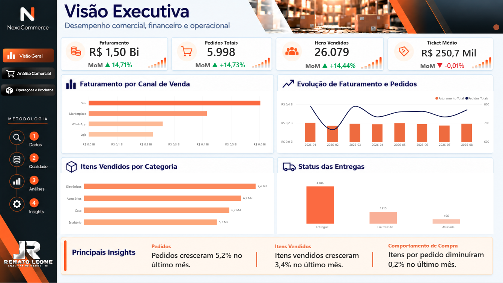
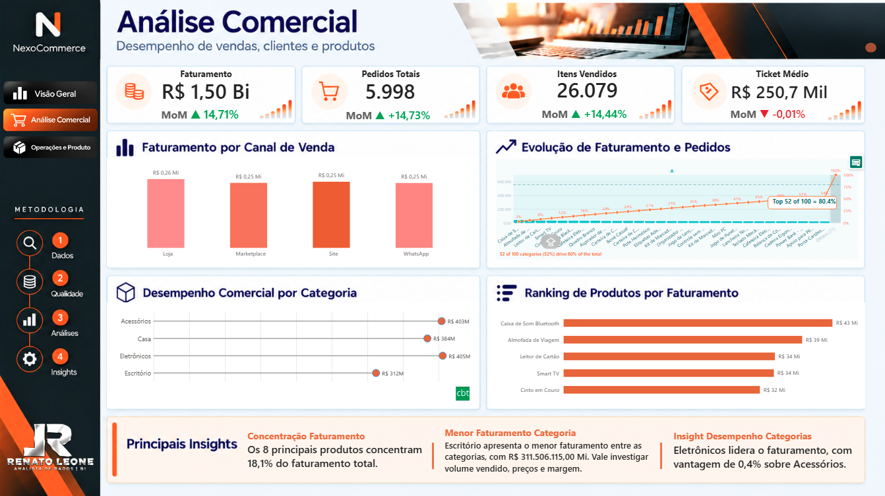
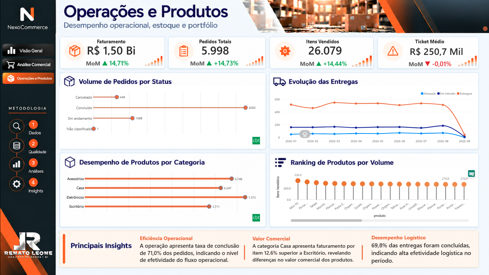

# 📊 NexoCommerce Analytics

## 📈 Análise de Dados e Business Intelligence — Projeto End-to-End

> **Projeto de portfólio desenvolvido para simular uma operação de comércio eletrônico, integrando preparação e validação de dados à análise comercial e operacional no Power BI.**

---

## 🎯 Problema de negócio

A NexoCommerce precisa de uma visão consolidada de sua operação para acompanhar o desempenho comercial e operacional e apoiar a tomada de decisão.

O projeto busca responder perguntas como:

- 💰 Qual é o faturamento e o volume de pedidos?
- 🛒 Como se distribuem as vendas por canal?
- 📦 Quais categorias e produtos se destacam em faturamento ou volume?
- 🚚 Como está o desempenho dos pedidos e das entregas?
- 🔎 Quais indicadores merecem atenção da gestão?

A proposta é transformar dados operacionais em **informações gerenciais e insights acionáveis**.

---

## 🏢 Visão empresarial

A solução reúne indicadores e análises em três perspectivas complementares:

- **Visão Executiva:** acompanhamento dos principais indicadores.
- **Análise Comercial:** comparação de canais, categorias e produtos.
- **Operações e Produtos:** acompanhamento dos status operacionais e do volume por produto.

> Os dados são sintéticos e utilizados exclusivamente para fins educacionais e de portfólio.

---

## 🗂️ Sobre os dados

| Característica | Descrição |
|---|---|
| **Fonte** | Dados sintéticos preparados para o projeto |
| **Contexto** | Comércio eletrônico |
| **Entidades** | Clientes, pedidos, itens de pedido, produtos, vendedores, pagamentos e entregas |
| **Formatos** | CSV e JSON |
| **Preparação** | Scripts Python de tratamento e validação |
| **Visualização** | Power BI |

Os arquivos estão organizados em três grupos: dados originais, dados tratados e registros em quarentena para análise de inconsistências.

---

## 🛠️ Tecnologias utilizadas

### 🐍 Python
Utilizado nas etapas de preparação e validação dos dados.

- Python
- Pandas
- Arquivos CSV e JSON

### 📊 Power BI
Utilizado para modelagem, indicadores e construção do dashboard.

- Power Query
- Modelo de dados e relacionamentos
- DAX
- KPIs e visualizações interativas

### 🗃️ Versionamento
- Git
- GitHub

---

## 🔄 Etapas do projeto

### 1. 📥 Organização dos dados
Separação dos arquivos originais, tratados e dos registros encaminhados para quarentena.

### 2. 🧹 Tratamento de dados
Preparação dos dados com o script `03_Scripts/01_etl_tratamento.py`.

### 3. ✅ Validação da qualidade
Verificação dos dados com `03_Scripts/02_validar_dados.py`, com registro de validação em `04_Documentacao/relatorio_validacao.csv`.

### 4. 📊 Análise e visualização
Construção de indicadores e visualizações no Power BI para explorar as dimensões comercial e operacional.

---

## 📌 Principais indicadores

O dashboard reúne indicadores como:

- 💰 **Faturamento**
- 🛒 **Pedidos**
- 📦 **Itens vendidos**
- 🎟️ **Ticket médio**
- 🚚 **Status e desempenho das entregas**
- 🧾 **Desempenho por categoria, canal e produto**

Os valores devem ser interpretados dentro do contexto dos dados sintéticos do projeto.

---

## 📊 Dashboard Power BI

### 🧭 01. Visão Executiva

Apresenta uma visão consolidada dos principais indicadores e permite acompanhar o desempenho geral da operação.



---

### 🛍️ 02. Análise Comercial

Explora o desempenho dos canais de venda, das categorias e dos produtos, incluindo comparações de faturamento e volume.



---

### 🚚 03. Operações e Produtos

Apresenta análises dos status dos pedidos e das entregas, além de comparações entre categorias e produtos por volume.



---

## 💡 Análises gerenciais

O dashboard permite explorar questões como:

- **Canais de venda:** comparar a contribuição dos canais para o faturamento e o volume de pedidos.
- **Categorias e produtos:** identificar diferenças de desempenho comercial e de quantidade vendida.
- **Pedidos e entregas:** acompanhar os status operacionais e observar pontos de atenção.
- **Indicadores integrados:** analisar os resultados em conjunto, considerando as limitações dos dados disponíveis.

> As análises são descritivas e não estabelecem relações causais nem representam resultados de uma empresa real.

---

## 🧩 Estrutura do projeto

```text
NexoCommerce_Analytics/
├── 01_Dados/
│   ├── 01_Originais/
│   ├── 02_Tratados/
│   └── 03_Quarentena/
├── 02_PowerBI/
│   └── NexoCommerce_Analytics.pbix
├── 03_Scripts/
│   ├── 01_etl_tratamento.py
│   ├── 02_validar_dados.py
│   ├── mapeamentos_sinteticos.json
│   ├── README.md
│   └── requirements.txt
├── 04_Documentacao/
│   └── relatorio_validacao.csv
├── 05_Portfolio/
│   ├── 01_VISÃO EXECUTIVA.png
│   ├── 02_ANÁLISE COMERCIAL.png
│   └── 03_OPERAÇÕES E PRODUTOS.png
└── README.md
```

---

## ▶️ Como explorar o projeto

1. Consulte `01_Dados/` para conhecer a organização dos arquivos.
2. Leia `03_Scripts/README.md` antes de executar os scripts.
3. Consulte `04_Documentacao/relatorio_validacao.csv` para ver o relatório de validação.
4. Abra `02_PowerBI/NexoCommerce_Analytics.pbix` no Power BI Desktop para explorar o dashboard.

> **Observação:** confira as instruções e os caminhos configurados nos scripts antes de executá-los em outro ambiente.

---

## ⚠️ Limitações e premissas

- Os dados são sintéticos e têm finalidade educacional.
- Os resultados não representam o desempenho de uma empresa real.
- As análises são descritivas e não comprovam relações de causa e efeito.
- A execução dos scripts pode exigir ajustes nos caminhos dos arquivos conforme o ambiente local.

---

## 🎓 Objetivo profissional

O NexoCommerce Analytics demonstra uma abordagem estruturada de **Análise de Dados e Business Intelligence**: organizar dados, tratar e validar informações, construir indicadores e comunicar resultados em um dashboard orientado ao negócio.

---

## 👤 Autor

**Renato Leone**  
Área: Data Analytics / Business Intelligence  
Projeto: NexoCommerce Analytics  
Tipo: Projeto de portfólio End-to-End
